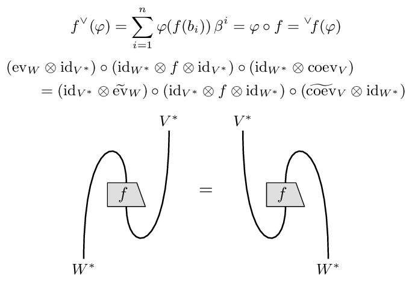

# Symmetry Examples

Examples for the course [FYAD11 Symmetry](https://www.kau.se/en/education/programmes-and-courses/courses/FYAD11). I hope to eventually make this a [Nordic Curriculum course](https://nordita.org/education/courses).

Recommended: read the Outlook (Ch.19) first, at least superficially.

More animations, with their equations: [string_diagram_animations](string_diagram_animations/README.md)

## Mathematica notebooks

Examples are numbered by chapter in the lecture notes.

- **1.0 Intro to groups and algebras:** [Mathematica](Mathematica_notebooks/arithmetic_to_groups_and_algebras.nb) · [PDF](Mathematica_notebooks/arithmetic_to_groups_and_algebras.pdf)
- **1.1 Three-spin recoupling:** [Mathematica](Mathematica_notebooks/three_spin_recoupling.nb) · [PDF](Mathematica_notebooks/three_spin_recoupling.pdf)
- **1.2 Invariant PDE:** [Mathematica](Mathematica_notebooks/invariant_PDE.nb) · [PDF](Mathematica_notebooks/invariant_PDE.pdf)
- **2.3 Three polarizers:** [Mathematica](Mathematica_notebooks/three_polarizers.nb) · [PDF](Mathematica_notebooks/three_polarizers.pdf)
- **3.1 Finite group $S_3$:** [Mathematica](Mathematica_notebooks/finite_groups_basic.nb) · [PDF](Mathematica_notebooks/finite_groups_basic.pdf)
- **3.2 Hopf algebra of tree graphs:** [Mathematica](Mathematica_notebooks/hopf_algebra_basic.nb) · [PDF](Mathematica_notebooks/hopf_algebra_basic.pdf)
- **4.1 Three masses and springs:** [Mathematica](Mathematica_notebooks/triangle_representation_matrices.nb) · [PDF](Mathematica_notebooks/triangle_representation_matrices.pdf)
- **4.2 Particle on a ring:** [Mathematica](Mathematica_notebooks/six_site_ring.nb) · [PDF](Mathematica_notebooks/six_site_ring.pdf)
- **11.1 Rotation from spin:** [Mathematica](Mathematica_notebooks/L_from_sigma.nb) · [PDF](Mathematica_notebooks/L_from_sigma.pdf)
- **12.1 Roots and weights for a three-level system:** *to appear*
- **13.1 Exchange energies for two spins:** *to appear*
- **16.1 Lorentz vs. fractional linear transformations:** [Video](https://youtu.be/f2J3M99XijI) · [Mathematica](Mathematica_notebooks/sl_from_so.nb) · [PDF](Mathematica_notebooks/sl_from_so.pdf)
- **16.2 Representing a Lie algebra by differential operators:** [Mathematica](Mathematica_notebooks/Differential_operators_from_algebra_SL_2.nb) · [PDF](Mathematica_notebooks/Differential_operators_from_algebra_SL_2.pdf)
- (**Background: rotation matrices for $\mathfrak{so}(3)$ Lie algebra:** [Mathematica](Mathematica_notebooks/so3.nb) · [PDF](Mathematica_notebooks/so3.pdf))
- **17.1 Frobenius condition for ${\mathbb C}S_3$:** [Mathematica](Mathematica_notebooks/frobenius_condition.nb) · [PDF](Mathematica_notebooks/frobenius_condition.pdf)
- **17.2 Levi-Civita $\epsilon$ as invariant tensor:** [Mathematica](Mathematica_notebooks/levicivita.nb) · [PDF](Mathematica_notebooks/levicivita.pdf)
- **18.1 The quantum three-body problem:** [Mathematica](Mathematica_notebooks/quantum_three_body.nb) · [PDF](Mathematica_notebooks/quantum_three_body.pdf)
- **19.1 From fusion to the pentagon identity:** [Mathematica](Mathematica_notebooks/from_fusion_to_solving_pentagon.nb) · [PDF](Mathematica_notebooks/from_fusion_to_solving_pentagon.pdf)
  - A human-readable introduction to this notebook: [Outlook: category theory](Mathematica_notebooks/category_theory_quantum_motivation.pdf)

## Python string diagrams

- **Student guide:** [PDF](python_string_diagrams/student_guide.pdf)
- **The 29 Python notebooks discussed in the Student guide:** [python_string_diagrams](python_string_diagrams/)
