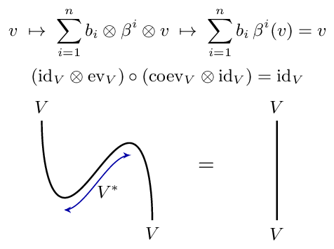
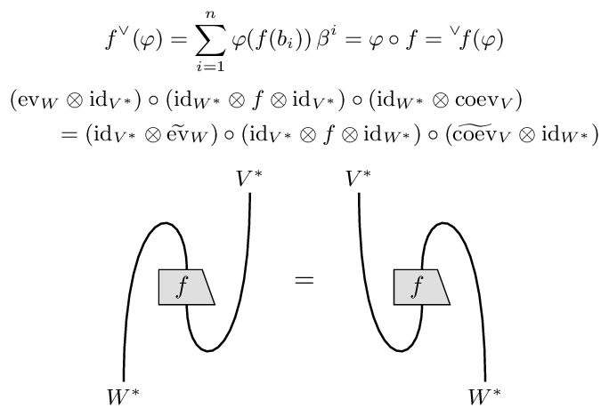
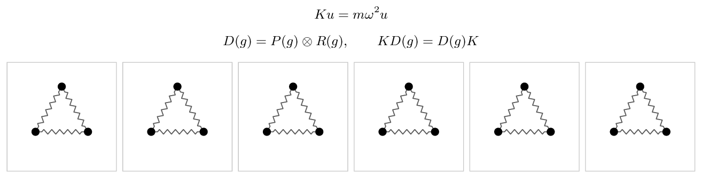
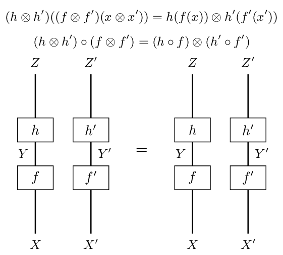
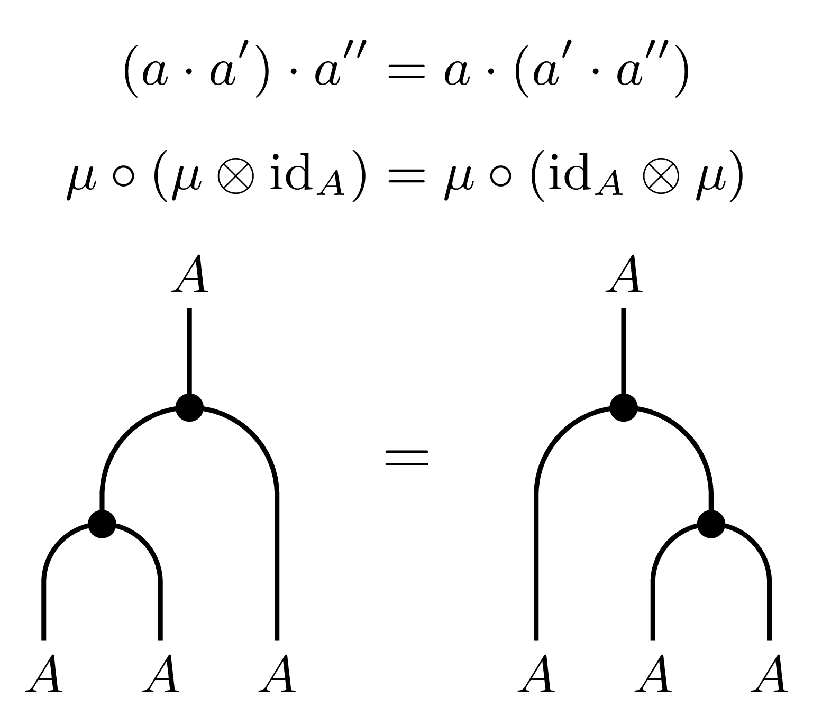
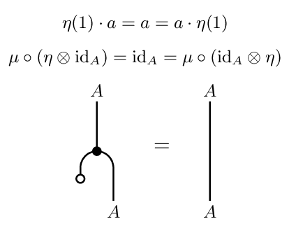
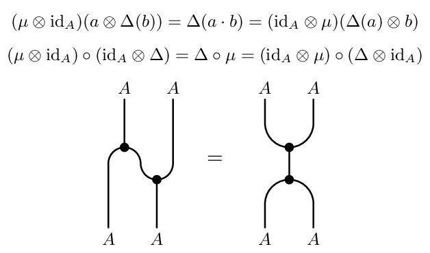

# String diagram animations

Each animation shows two equations above the pictures: first applied to elements, then as an equation of maps.

### Composition of maps

### Snake identity

### Dual map

The same animation [without equations](dual_map_2_92.gif).

### A proof by crossing two wires: k k F = 0

### Representation property

### Unit of an action

### Intertwiner

### Trace and character

### Normal modes of three masses and springs

### Interchange law

### Associativity

### Unit

### Coassociativity

### Counit

### Frobenius property

### Crossing and its inverse

### Double braiding

